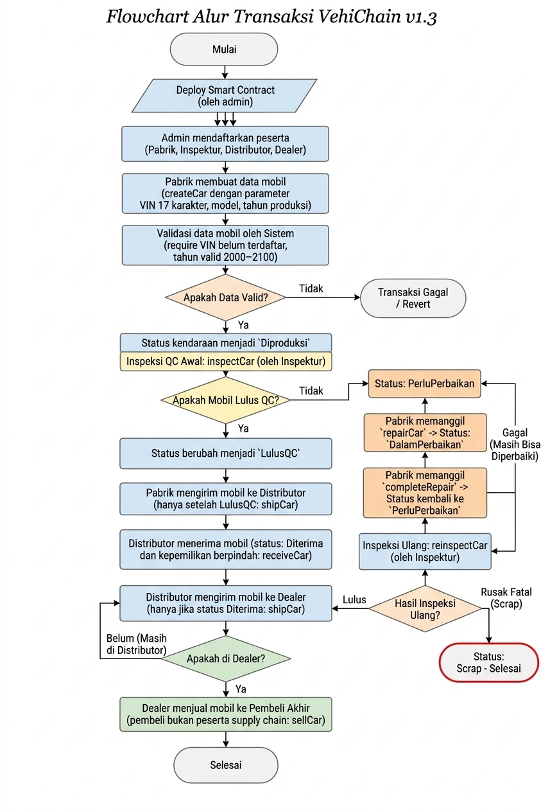

# LAPORAN TUGAS STRUKTUR
**VehiChain: Sistem Pelacakan Rantai Pasok Kendaraan Berbasis Smart Contract**

- **Mata Kuliah:** Blockchain
- **Program Studi:** Informatika
- **Kelompok:** 3
- **Anggota Tim:**
  1. Nizar Aftana (2530801097)
  2. Wahyu (2530801103)
  3. Wafah Khonia (2530801081)

---

## 1. Latar Belakang dan Solusi Blockchain

### 1.1 Latar Belakang
Rantai pasok atau *supply chain* merupakan rangkaian proses yang menghubungkan produsen dengan konsumen melalui beberapa pihak, seperti pemeriksa kualitas, distributor, dan dealer. Dalam distribusi kendaraan, informasi mengenai identitas kendaraan, hasil pemeriksaan kualitas, penanganan unit yang ditolak QC, proses perbaikan, pengiriman, serta perpindahan kepemilikan perlu dicatat secara terstruktur agar riwayat kendaraan dapat ditelusuri.

Apabila pencatatan dilakukan secara terpisah oleh setiap pihak, proses pencocokan informasi dan pemeriksaan riwayat kendaraan dapat menjadi lebih sulit. Oleh karena itu, diperlukan sistem yang dapat mencatat aktivitas distribusi dan menerapkan aturan transaksi berdasarkan kewenangan masing-masing pihak.

### 1.2 Solusi yang Diusulkan
Proyek **VehiChain** merupakan prototipe sistem pelacakan distribusi kendaraan menggunakan teknologi *blockchain* dan *smart contract* Solidity. Sistem ini dirancang untuk mencatat perjalanan kendaraan dari pabrik hingga pembeli, dengan tahapan pemeriksaan kualitas atau *Quality Control* (QC), proses perbaikan kendaraan jika ditolak QC, inspeksi ulang, *scrap* (pemusnahan unit rusak berat), pengiriman ke distributor/dealer, penerimaan unit, hingga penjualan kepada pembeli akhir.

*Smart contract* mengatur hak akses berdasarkan peran pengguna, memvalidasi setiap transaksi, serta mencatat aktivitas melalui *event*. Data kendaraan disimpan menggunakan struktur data `Car`, sedangkan status kendaraan diperbarui secara dinamis sesuai tahapan distribusi.

> **Catatan Integritas Data:** Penggunaan *blockchain* diharapkan meningkatkan keterlacakan dan integritas catatan transaksi. Meskipun demikian, sistem ini merupakan prototipe dan tidak secara otomatis menjamin kebenaran informasi yang dimasukkan oleh pengguna ataupun kondisi fisik kendaraan.

---

## 2. Desain Entitas: Struct dan Mapping

### 2.1 Enum
*Smart contract* menggunakan tiga *enum* utama untuk mengategorikan entitas sistem secara terstruktur:
- **`Role`**: Menentukan peran pengguna, meliputi `None`, `Pabrik`, `Inspektur`, `Distributor`, dan `Dealer`.
- **`VehicleModel`**: Menentukan pilihan model kendaraan, yaitu `Sedan`, `SUV`, dan `Listrik`.
- **`Status`**: Menunjukkan tahapan kendaraan, meliputi `Diproduksi`, `LulusQC`, `Ditolak`, `DalamPerbaikan`, `DalamPengiriman`, `Diterima`, `Terjual`, `PerluPerbaikan`, dan `Scrap`.

*Enum* digunakan agar pilihan data lebih terstruktur dan sesuai dengan kategori yang telah ditentukan dalam program.

### 2.2 Struct Car
*Struct* `Car` digunakan untuk mengelompokkan informasi setiap kendaraan dalam satu struktur data yang komprehensif:

| Atribut | Keterangan |
| :--- | :--- |
| `id` | Identitas unik kendaraan dalam sistem (`uint256`) |
| `vin` | Nomor identifikasi kendaraan / *Vehicle Identification Number* (17 karakter) |
| `model` | Model kendaraan (`VehicleModel`) |
| `tahunProduksi` | Tahun produksi kendaraan (`uint16`) |
| `pabrik` | Alamat *wallet* pabrik pembuat |
| `pemilik` | Alamat *wallet* pemilik sah saat ini |
| `penerima` | Alamat *wallet* tujuan penerima pengiriman |
| `status` | Status terkini kendaraan dalam rantai pasok |
| `diperbarui` | Waktu (*timestamp*) terakhir data diperbarui |

### 2.3 Mapping
*Smart contract* menggunakan tiga *mapping* utama untuk menyimpan data *state* di *blockchain*:
- `mapping(address => Role) public roles`: Menghubungkan alamat *wallet* dengan peran pengguna.
- `mapping(uint256 => Car) private cars`: Menghubungkan ID kendaraan dengan data kendaraan berbentuk *struct* `Car`.
- `mapping(bytes32 => bool) private vinTerdaftar`: Menandai apakah *hash* VIN sudah terdaftar sehingga pendaftaran VIN ganda dapat ditolak secara otomatis.

Kombinasi *struct* dan *mapping* memungkinkan kontrak mengelola data kendaraan berdasarkan ID, memeriksa kewenangan pengguna, serta menjaga integritas data secara desentralisasi.

### 2.4 Aturan Keamanan dan Pencatatan
Validasi transaksi dilakukan secara ketat menggunakan fungsi `require` dan *modifier* khusus (`onlyAdmin`, `onlyRole`, `mobilAda`, `alasanValid`). Contohnya, hanya admin yang dapat mendaftarkan peserta, hanya inspektur yang dapat melakukan inspeksi dan *scrap*, serta hanya pemilik sah yang dapat memulai perbaikan atau mengirim kendaraan.

*Event* seperti `ParticipantRegistered`, `CarCreated`, `CarInspected`, `CarRepairStarted`, `CarRepairCompleted`, `CarReinspected`, `CarScrapped`, `CarShipped`, `CarReceived`, dan `CarSold` digunakan untuk menghasilkan log aktivitas terindeks pada *blockchain*. Log ini memudahkan pemantauan riwayat secara *real-time*.

---

## 3. Flowchart Alur Transaksi

Berikut adalah alur operasional utama dan urutan eksekusi transaksi pada sistem **VehiChain**:

### 3.1 Penjelasan Alur Perbaikan dan Pengelolaan Unit (`PerluPerbaikan` & `Scrap`)
1. **Inspeksi QC Awal (`inspectCar`):** Jika inspektur menilai kendaraan tidak lulus, status berubah menjadi `PerluPerbaikan`.
2. **Proses Perbaikan (`repairCar` & `completeRepair`):** Pabrik memulai perbaikan (`DalamPerbaikan`), lalu menyelesaikan perbaikan (`completeRepair`) untuk mengembalikan status ke `PerluPerbaikan` sebelum diuji ulang.
3. **Inspeksi Ulang (`reinspectCar`) atau Scrap (`scrapCar`):** 
   - Jika lulus uji ulang, status kembali ke `LulusQC`. 
   - Jika rusak fatal, inspektur dapat langsung melakukan *scrap* untuk mengeluarkan unit dari sistem.

---

## 4. Kesimpulan

**VehiChain** merupakan prototipe *smart contract* yang efisien, tangguh, dan aman untuk mencatat serta melacak distribusi kendaraan dari pabrik hingga konsumen akhir. Implementasi struktur data berbasis *enum*, *struct*, dan *mapping* yang dikombinasikan dengan mekanisme *role-based access control* (RBAC), siklus penanganan unit cacat (`PerluPerbaikan` dan `Scrap`), serta *event logging* yang komprehensif berhasil mewujudkan transparansi dan akuntabilitas dalam rantai pasok otomotif.